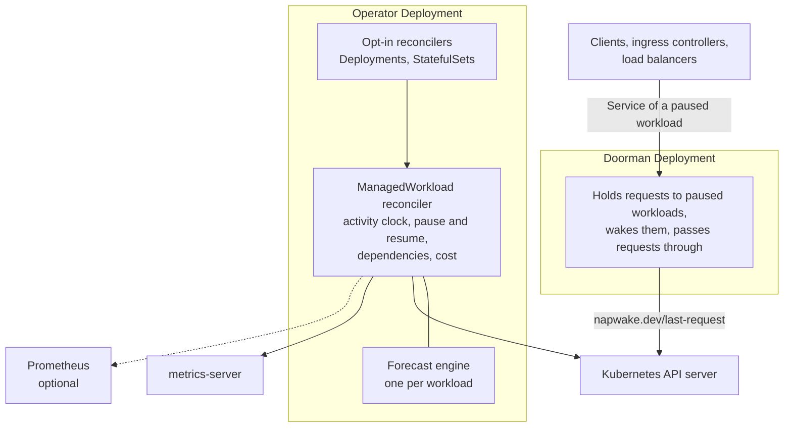

import NextSteps from '../../../components/NextSteps.astro';

Napwake is a Kubernetes operator built on [controller-runtime](https://github.com/kubernetes-sigs/controller-runtime). The [doorman](/concepts/wake-on-request/) wakes paused workloads on request.

## Reconcilers

The operator runs two kinds of reconciliation loop.

### ManagedWorkload reconciler

The main one. It watches `ManagedWorkload` CRs and drives each workload through its [lifecycle](/concepts/lifecycle/).

- A reconcile times out after 2 minutes.
- `--max-concurrent-reconciles` workloads are reconciled at once, 8 by default. One slow metrics or Prometheus query doesn't hold up another workload's wake.
- Each workload's forecast engine runs in memory. It's saved to `status.prediction.state` each hour it learns, so it survives operator restarts and leader changes.
- Reconciles wait in one queue, so a wake isn't queued behind every workload's checks:

| Order | Reconciles |
|-------|------------|
| First | What wakes a workload. A request the doorman holds, an activity or pause annotation, a scale-up from zero |
| Also first | A resume under way |
| Then | Other changes |
| Last | Periodic checks of awake and paused workloads, with their metrics and Prometheus queries |

One reconcile, step by step

1. Checks no other ManagedWorkload manages the target.
2. Checks the target exists and isn't labelled `napwake.dev/ignore`. Lets an ignored one go.
3. Lets a [protected](/reference/conditions-and-events/#condition-protected) one go. Both scale a paused one back up first.
4. Wakes a paused workload scaled up outside Napwake.
5. Reports the HPA or KEDA ScaledObject scaling it.
6. Learns its dependencies from its environment and from requests that woke it.
7. Routes a paused workload's Services to the doorman, or stops routing them.
8. Finishes a pause or resume an earlier reconcile started, from the target's `napwake.dev/paused-from` if status lost it. Wakes a paused workload put in dry-run.
9. Leaves alone a target scaled to zero outside Napwake.
10. Acts on `kubectl napwake pause`.
11. Runs the activity clock and the forecast, to [pause](/concepts/idle-detection/#the-decision) the workload or [wake](/concepts/idle-detection/#waking-up) it.
12. Adds up what dry-run held back, accumulates cost, and writes status.

### Opt-in reconcilers

One for Deployments, one for StatefulSets. Each watches its workloads, their namespaces, and the ManagedWorkloads created from them. It turns the `napwake.dev/managed: "true"` label into a ManagedWorkload, as [Opting in](/guides/opt-in/) describes.

## Internal packages

| Package | Does |
|---------|------|
| `internal/controller` | The reconcilers |
| `internal/forecast` | Holt-Winters model, phase lifecycle, confidence scoring, anomaly detection |
| `internal/signal` | Prometheus activity queries |
| `internal/autoscaler` | Finds HPAs and KEDA ScaledObjects. Holds a KEDA one at zero while paused |
| `internal/gitops` | Tells from field managers whether a GitOps tool sets the replicas, and how to tell it to leave them |
| `internal/lifecycle` | Pause and resume, through the scale subresource |
| `internal/discovery` | `kubectl napwake scan` |
| `internal/doorman` | The doorman |
| `internal/cost` | Rates, node list prices, monthly projection |
| `internal/metrics` | Metric definitions, and the Kubernetes Metrics API reader |

## External dependencies

| System | Napwake uses it to |
|--------|--------------------|
| Kubernetes API server | Scale workloads, and route Services' EndpointSlices to the doorman |
| Kubernetes API server, for pricing and dependencies | Read pods, PVCs, nodes' labels, ConfigMaps, HPAs and KEDA ScaledObjects |
| metrics-server, required | Read pod CPU |
| Prometheus, optional | Run PromQL activity queries |

## Freed and saved

Napwake works at the workload layer, and doesn't manage nodes. What a pause or scale-down frees comes off the bill once a node autoscaler removes nodes.

Every 5 minutes, the leader measures what's [saved](/concepts/cost-tracking/#how-saved-is-measured), from cached nodes and pods. Every 10 minutes, it exports which node autoscaler runs as `napwake_node_autoscaler`.

## Leader election

For high availability, run several operator replicas with `--leader-elect`, controller-runtime's leader election. Only the leader reconciles, and a standby takes over if it fails. Every doorman replica serves traffic, with no leader.

## Security model

- The operator runs as non-root, in a distroless container.
- RBAC is scoped to the minimum. See [Data and access](/reference/data-and-access/#rbac).
- Metrics are served over HTTPS, with authentication, by default.
- HTTP/2 is off by default, to mitigate known vulnerabilities.

<NextSteps
  doorman={false}
  items={[
    { href: '/concepts/lifecycle/', title: 'Lifecycle', text: 'The phases a workload moves through.' },
    { href: '/guides/cluster-autoscaler/', title: 'Cluster Autoscaler', text: 'Turning what a pause frees into savings.' },
  ]}
/>
