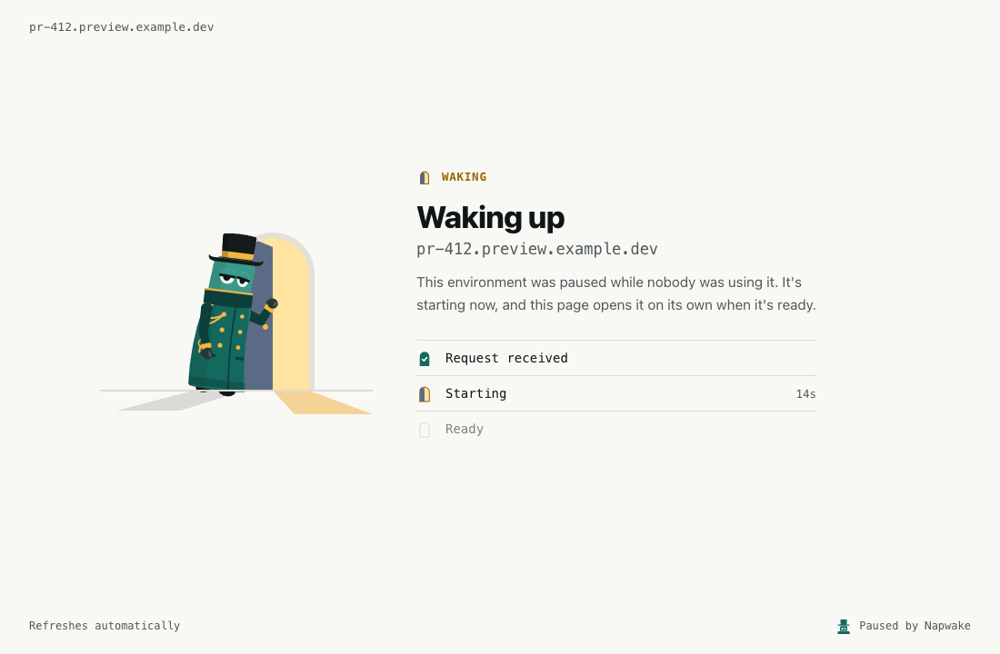

import Scene from '../../../components/Scene.astro';
import AtAGlance from '../../../components/AtAGlance.astro';
import StateFlow from '../../../components/StateFlow.astro';
import BrowserFrame from '../../../components/BrowserFrame.astro';
import Outcome from '../../../components/Outcome.astro';
import NextSteps from '../../../components/NextSteps.astro';

<Scene
  rooms={[{ state: 'asleep', label: 'dev' }, { state: 'waking', label: 'staging' }, { state: 'asleep', label: 'preview-42' }, { state: 'awake', label: 'qa' }]}
  width={760} height={300} x0={42} floorY={252} scale={1.02} doormanAt={1}
  label="A request wakes staging, and the doorman holds it at the door. dev and preview-42 are asleep, and qa is awake."
  caption="A request reached staging while it was paused. The doorman holds it while staging starts, then passes it to the first Ready pod."
/>

A paused workload has no pods, so nothing answers its Service. The first request wakes it.

The doorman holds the connection until a pod is Ready, then passes it through. The caller usually sees one slow response ([the exceptions](#what-the-caller-sees)).

The wait is as long as the pods take to start and pass their readiness probe. For the [Quickstart's](/getting-started/quickstart/#6-wake-it-with-a-request) nginx, that's a second or two.

On a public URL, the doorman can [ask before waking](#asking-before-waking) instead. Then only a person's click wakes it.

<AtAGlance
  items={[
    { label: 'Default', value: 'On for every workload Napwake pauses on its own, with nothing to configure' },
    { label: 'On a public URL', value: '<code>ask</code>: a browser gets a <b>Wake it</b> button, and crawlers, scanners and API calls wake nothing' },
    { label: 'Protocols', value: 'Any TCP, such as HTTP, gRPC, Postgres and Redis' },
    { label: 'Holds a request', value: 'Up to <code>wake.maxWait</code>, 2 minutes by default' },
    { label: 'Browsers', value: 'A waking-up page that reloads every 3 seconds' },
  ]}
/>

## How it works

The doorman is a small proxy, its own Deployment beside the operator, with two replicas and a PodDisruptionBudget.

<StateFlow
  label="A request to a paused workload, held while it wakes, then passed through"
  steps={[
    { state: 'asleep', title: 'Routed to the doorman', text: 'Its Services point at the doorman.' },
    { state: 'waking', title: 'Held, and woken', text: 'The doorman holds the connection and wakes the workload.' },
    { state: 'awake', title: 'Passed through', text: 'A Ready pod gets the connection.' },
  ]}
  between={['A caller connects and sends something', 'A pod is Ready']}
/>

| When | What happens |
|------|--------------|
| The workload starts to pause | The operator adds an EndpointSlice, one per IP family, to each Service that selects its pods. It points at the doorman, on a port of its own (20000-29999). The Service, ClusterIP and DNS name don't change, so callers and Ingresses need no changes. IPv4, IPv6 and dual-stack all work. The slice is in place before the pods stop, so no request is refused as they do ([What happens in a pause](/guides/pause/#what-happens-in-a-pause)) |
| A connection arrives | If a pod of the Service is already Ready, it goes straight there. That happens while it's still pausing or already waking, or when another workload's pods serve the Service. While it's pausing, a request passed on that would wake it [calls the pause off](/guides/pause/#a-request-calls-the-pause-off). Otherwise the doorman waits for the caller to send something |
| The caller sends something | The doorman holds the connection and sets `napwake.dev/last-request` on the ManagedWorkload, which wakes it like an [activity annotation](/concepts/idle-detection/#activity-annotations). A `WokenByRequest` event names the Service. Once Running, the clock shows `lastActivitySource: request` |
| A pod is Ready | The doorman, watching the Service's own EndpointSlices, passes the held connection to a Ready pod, with the bytes already sent |
| The workload is `Running` | The operator removes the doorman's EndpointSlices. For 30 seconds the doorman still passes stray connections to Ready pods, waking nothing, while kube-proxy and load balancers catch up |

The doorman works on TCP connections, not HTTP requests. Waking a workload wakes its [dependencies](/concepts/dependencies/) too.

Ingress controllers, Gateway API implementations and cloud load balancers that read EndpointSlices reach the doorman the same way ([the ones checked](/reference/compatibility/)). A routed workload reports this:

```
WakeOnRequest=True   DoormanRouted   requests are held and wake the workload
```

### Readiness probes

The doorman lets a held request through once a pod is Ready. Ready comes from the readiness probe. Without one, a pod is Ready when its containers start, often before the app can serve.

The request then gets whatever the app answers, such as a `503`. Give the app a probe that passes only once it can serve. If the app isn't listening yet, the doorman retries every second until `maxWait`.

```yaml title="deployment.yaml"
spec:
  template:
    spec:
      containers:
        - name: api
          readinessProbe:
            httpGet:
              path: /ready   # answers 200 only once the app can serve requests
              port: 8080
            periodSeconds: 2
```

| Probe | Effect |
|-------|--------|
| A short `periodSeconds` | Passes held requests on sooner |
| A `startupProbe` | Gates readiness too |
| A `tcpSocket` probe on the app's port | Enough for an app that listens only once it's ready |
| None in any container, and no readiness gates | Napwake reads the pod template when it routes the workload. The `WakeOnRequest` condition says so, and a `NoReadinessProbe` warning event points here, once each pause |

### What wakes a workload, and what doesn't

| The caller | What happens |
|------------|--------------|
| Sends bytes, such as an HTTP request, a TLS handshake or a database protocol's first message | <Outcome state="waking">Held. It wakes</Outcome> |
| Connects, then sends nothing for 3 seconds | <Outcome state="waking">Held. It wakes, taken for a protocol where the server speaks first, such as MySQL</Outcome> |
| Connects and closes without sending, like a TCP health check | <Outcome state="asleep">Closed</Outcome> |
| `GET` or `HEAD` from a known probe, scraper or uptime monitor, by `User-Agent` (below) | <Outcome state="asleep">`503 Service Unavailable`, `Connection: close`. These would otherwise keep it awake forever</Outcome> |
| `GET` or `HEAD` from Google Cloud's load balancer health check, `GoogleHC/` | <Outcome state="asleep">`200 OK`. Google's load balancers send nothing to a backend that fails its check, so they'd drop the request that should wake it</Outcome> |
| `GET` or `HEAD` from a prefix you added in the Helm value `doorman.healthCheckUserAgents` | <Outcome state="asleep">`503`</Outcome> |
| Any other method from those agents, such as a Prometheus remote write or an Alertmanager `POST` | <Outcome state="waking">Held. It wakes, since that's data for it</Outcome> |
| A hidden file, whose path has a part that starts with a dot, such as `/.env`, `/.git/config` or `/.aws/credentials`, except under `/.well-known/` | <Outcome state="asleep">`404 Not Found`. No app serves these to its users, and scanners hunt them for leaked secrets</Outcome> |

Checkers get these answers only while no pod is Ready. Then they pass through.

<details class="nw-details">
<summary>The User-Agents the doorman knows</summary>

| | Prefixes |
|---|---|
| Built in | `kube-probe/`, `Prometheus/`, `Blackbox Exporter/`, `vm_promscrape`, `GrafanaAgent/`, `Alloy/`, `OpenTelemetry Collector`, `otelcol`, `Datadog Agent/`, `Datadog/Synthetics`, `ELB-HealthChecker/`, `Amazon-Route53-Health-Check-Service`, `GoogleStackdriverMonitoring-UptimeChecks`, `Envoy/HC`, `Mozilla/5.0+(compatible; UptimeRobot/`, `Pingdom.com_bot`, `NewRelicPinger/`, `Uptime-Kuma/`, `Gatus/` |
| Yours | Each one in `doorman.healthCheckUserAgents` |
| After `(compatible; ` | Any of them, built in or added, as in `Mozilla/5.0 (compatible; MyCorpMonitor/3.1)` from a monitor posing as a browser |

</details>

Add your own checkers' prefixes, cluster-wide:

```yaml
doorman:
  healthCheckUserAgents: ["MyCorpMonitor/", "status-checker"]
```

To keep the doorman off a port, list it on the Service by name or number. A metrics port something else scrapes is an example. Listed ports are never routed, so they fail while the workload is paused.

```yaml
kind: Service
metadata:
  annotations:
    napwake.dev/doorman-ignore-ports: "metrics"   # or "9090", or both: "metrics,9090"
spec:
  ports:
    - name: http
      port: 80
    - name: metrics
      port: 9090
```

### Health checks the doorman can't recognise

The doorman knows a health check only by reading it. Two kinds can't be read, and wake a paused workload on its traffic port every time they run. So it never stays paused longer than their interval.

| Check | Why it can't be read |
|-------|----------------------|
| HTTPS and other TLS checks | The `User-Agent` is encrypted. AWS target groups that use HTTPS check over HTTPS by default, as do Google Cloud backend services on HTTPS or HTTP/2 |
| HTTP checks and scrapers with a `User-Agent` the doorman doesn't know | It looks like a caller, as from an uptime monitor you haven't added to `doorman.healthCheckUserAgents` |

`napwake.dev/doorman-ignore-ports` can't help on the traffic port, since ignoring it would stop requests waking the workload too. Do one of these instead:

| Fix | What to know |
|-----|--------------|
| Check over plain HTTP | AWS's and Google's checkers send a `User-Agent` the doorman knows, and get `503` and `200`, waking nothing |
| Check a port served only for health checks, listed in `napwake.dev/doorman-ignore-ports` | Not behind a GKE Ingress or Gateway. Nothing answers that port while the workload is paused, so Google's load balancer sees no healthy backend and sends nothing on |

Most load balancers see a paused workload as unhealthy, as they would without Napwake. Then they do this:

| Load balancer | With every target unhealthy |
|---------------|-----------------------------|
| AWS Application and Network Load Balancers | <Outcome state="waking">Fail open. The first request reaches the doorman and wakes the workload</Outcome> |
| Google Cloud Application Load Balancers, behind a GKE Ingress or Gateway | <Outcome state="waking">Answer `502` and send nothing on, until a backend passes its check. So the doorman answers `GoogleHC/` with `200 OK`, waking nothing, and holds the request that follows</Outcome> |
| Any other | Check it before relying on wake on request behind it |

### Environments on the public internet

On the public internet, have the doorman [ask before waking](#asking-before-waking), with `napwake.dev/wake: "ask"`. A browser then gets a **Wake it** button, and crawlers, scanners and API calls wake nothing. [Public preview environments](/guides/preview-environments/) walks through it.

| The environment | `wake` | A request while it's paused |
|-----------------|--------|-----------------------------|
| Behind a VPN or single sign-on at the ingress, or an allowlist of your offices' and VPN's addresses | `request`, the default | <Outcome state="waking">Held while the workload wakes</Outcome> |
| Anyone can reach it | `ask` | <Outcome state="asleep">A browser gets a **Wake it** button. Anything else gets a `503`</Outcome> |

With `request`, the doorman wakes for any request it can't tell is a health check. On the public internet most are robots. They're search engine crawlers, and scanners that try every address for known weaknesses.

Many send a browser's `User-Agent` on purpose, so no list keeps up. Once an environment has an HTTPS certificate, its hostname is in public certificate logs within minutes. Scanners then reach it by name.

A paused workload anyone can reach would wake every few minutes, and free little. `request` turns away only the hidden-file scanners.

With `ask`, it still wakes in other ways. Tooling sets the [wake annotation](/guides/preview-environments/#waking-it-from-tooling), as [`kubectl napwake wake`](/getting-started/kubectl-plugin/#wake-a-workload) does, whatever the wake setting. Behind the doorman, the [forecast](/concepts/forecasting/#what-an-hour-records) learns from people's wakes, and with `autoResume` has it up before they come.

It also wakes from CI through an [activity annotation](/concepts/idle-detection/#activity-annotations), when a [dependent](/concepts/dependencies/) wakes, or when something else scales it up. A [Prometheus activity query](/guides/prometheus-signals/) that counts ingress requests counts crawlers' requests too, so it would let them wake it. Don't count requests there, or filter bots out.

### Services shared with other workloads

A Service goes to the doorman only while none of its pods is Ready.

| Behind one Service | What happens |
|--------------------|--------------|
| Another workload's pods are Ready, as with a canary beside a stable Deployment | Traffic goes to them. A paused workload reports `WakeOnRequest=False`, reason `ServedByOtherPods` |
| Every workload is paused | The Service is routed, and a request wakes them |
| The other pods all go | The Service is routed within 30 seconds, and until then requests to it fail. The operator doesn't cache other workloads' endpoints. It reads the Service's EndpointSlices from the API server, and decides again every 30 seconds while other pods serve it |

## Asking before waking

```yaml
spec:
  wake:
    mode: Ask     # the default is Request, any request wakes it
```

The doorman then wakes the workload only when a person asks. Crawlers, scanners and API clients still reach the doorman, and nothing they send wakes it. With the label, set `napwake.dev/wake: "ask"` on the workload or its namespace.

For the cluster, set `defaults.wake: ask` ([The wake setting](#the-wake-setting)). [Public preview environments](/guides/preview-environments/) walks through it.

| `wake.mode` | A browser opening a page, while it's paused | Any other caller |
|-------------|----------------------------------------------|------------------|
| `Request`, the default | <Outcome state="waking">Wakes it, and gets the [waking-up page](#browsers)</Outcome> | <Outcome state="waking">Held while it wakes, unless it's a [known probe](#what-wakes-a-workload-and-what-doesnt)</Outcome> |
| `Ask` | <Outcome state="asleep">Gets the asleep page. Only a click on **Wake it** wakes it</Outcome> | <Outcome state="asleep">Gets a `503`, and wakes nothing</Outcome> |

`WakeOnRequest` says the doorman asks:

```
WakeOnRequest=True   DoormanRouted   the doorman asks a person's browser before waking the workload, and turns away other requests
```

### What browsers, robots and API clients see

| The caller | What happens |
|------------|--------------|
| A person's browser opening a page | <Outcome state="asleep">The asleep page, with a **Wake it** button</Outcome> |
| A click on **Wake it**, from a browser that says it came from the page | <Outcome state="waking">Wakes it, as a held request does. The waking-up page follows</Outcome> |
| A click whose button has run out, as on a page left open while its reloads failed | <Outcome state="asleep">The asleep page again, a `403`, saying nothing woke, as the page may have been open too long, with a fresh button</Outcome> |
| A click the browser says came from a page at another address. That's another site or subdomain. Or, over plain HTTP, an `Origin` that isn't the page's, as behind a proxy that rewrites `Host` | <Outcome state="asleep">The asleep page again, a `403`, saying the click came from another address. It says someone with access to the cluster can wake it with `kubectl napwake wake`</Outcome> |
| A click within a minute of the last wake request | <Outcome state="asleep">The asleep page again, a `429` with `Retry-After: 60`, saying to try again in a minute</Outcome> |
| A click from a browser that doesn't say it came from the page, one from before about 2020 | <Outcome state="asleep">The asleep page again, saying so. It says to use a current browser, or that someone with access to the cluster can wake it with `kubectl napwake wake`</Outcome> |
| A browser posting a form that isn't the button's, such as the app's login after the pause | <Outcome state="asleep">The asleep page, a `200`, as for a page load. It isn't counted as [turned away](#what-it-turns-away)</Outcome> |
| Anything else | <Outcome state="asleep">`503 Service Unavailable` with `Retry-After: 300`, and a short body saying it's asleep and how to wake it</Outcome> |
| A connection that isn't HTTP, such as a database protocol, or TLS the doorman can't read | <Outcome state="asleep">Closed, with nothing sent</Outcome> |
| A known probe, health check or hidden file | <Outcome state="asleep">Answered as for any workload ([above](#what-wakes-a-workload-and-what-doesnt))</Outcome> |
| Anything, once the workload is waking | <Outcome state="waking">As with `Request`. A browser gets the waking-up page, and the rest is held until it's Ready</Outcome> |

<details class="nw-details">
<summary>How the doorman tells them apart</summary>

| | How |
|---|---|
| A person's browser opening a page | A `GET` with `Sec-Fetch-Mode: navigate`, or asking for HTML, from a `User-Agent` that starts with `Mozilla/` and names no crawler |
| The asleep page | A `200` with `Cache-Control: no-store`, `X-Robots-Tag: noindex` and `Referrer-Policy: same-origin`. It reloads every minute |
| The asleep page's `Content-Security-Policy` | Allows its own style and script, and images only from `data:`. Its form posts only back to the page's address. No other site may show it in a frame, which `X-Frame-Options: DENY` says too |
| A tab left open | Its reload goes on to the app once someone has woken it |
| The click | Stamps `napwake.dev/last-request`, and a `WokenByRequest` event says a person asked. The waking-up page reloads the page the person opened until the app answers |
| A form that isn't the button's | URL-encoded and up to 1 KiB, or sent on chunked by a proxy |
| Anything else | `curl`, scripts and API clients, crawlers and link previewers such as `Googlebot` and `facebookexternalhit`, headless browsers, scanners, a `HEAD`, a WebSocket, a browser's `fetch`, a larger form or a file upload |
| The `503`'s body | JSON for a client that asks for it, and plain text otherwise |

</details>

A robot that passes for a browser gets the page, and wakes nothing either. Only a post of the page's token wakes the workload. It must be fresh, and from a browser's `User-Agent` that says the click came from the page:

| Where | The browser says so with |
|-------|--------------------------|
| It sends fetch metadata, as current browsers do over HTTPS | `Sec-Fetch-Site: same-origin`, a page of the same scheme, host and port |
| The same, from Chrome, Edge, Firefox and other Chromium browsers | `Sec-Fetch-User: ?1` too, which marks a navigation a person started. Safari, and every browser on iOS, never send it, so their clicks are judged by the rest |
| It doesn't, as no browser does over plain HTTP | An `Origin` that's the address the page was served at. That's the host its request named, shown at the top of the page, and its port |
| Over plain HTTP, behind a proxy that rewrites the `Host` header | The two differ. Serve the workload over HTTPS there |

The page's `Referrer-Policy: same-origin` lets the browser send that `Origin`, and sends nothing to other sites. So a spider that fetches the page and posts its token wakes nothing, even with a browser's `User-Agent`. Nor does a script that submits the form.

A robot that forges those headers on purpose, or drives a real browser and clicks, still can. That's rare, and costs at most a wake a minute. A browser from before about 2020 may send neither.

Its click can't be told from a spider's, so it wakes nothing, and the page says so. It says to use a current browser, or to have someone with cluster access run `kubectl napwake wake`.

The pages name no namespace, workload or Service, so they give nothing away to whoever reaches them.

### The Wake it button

The button posts back to the address of the page the person opened. So it reaches the same workload however an ingress routes it, a path prefix included.

| | The button's token |
|---|---|
| Signed for | That workload and that pause, named by when the pause began (`status.pause.startedAt`). It wakes no other, nor the same one in a later pause |
| Good for | 10 minutes |
| On a page shown as the workload pauses | It's for that pause. Its click [calls the pause off](/guides/pause/#a-request-calls-the-pause-off), or wakes the workload once it's paused |
| Kept fresh | By the page reloading every minute. That also takes a tab left open on to the app once someone has woken it |
| Expired anyway, as on a page whose reloads failed | <Outcome state="asleep">Wakes nothing. The page says so, as a `403`, and offers the button again</Outcome> |
| Posted from a page of another site, subdomain or port | <Outcome state="asleep">Wakes nothing, as `Sec-Fetch-Site` or the `Origin` says. The page says how else to wake it</Outcome> |
| Shown in a frame | No other site can show the page in a frame |

The doorman's replicas sign with one key, since a click can reach any of them. It's in a Secret the chart creates empty, `napwake-doorman-wake-key` for a release named `napwake`.

The first doorman pod to find it empty fills it with a random key. Helm and GitOps tools never set its data, so they leave the key alone.

To change the key, empty the Secret. Each doorman pod uses the new one within a minute. It stops accepting the old one 11 minutes after it switches, once every token signed with it has expired.

```bash
kubectl patch secret napwake-doorman-wake-key -n napwake-system --type=json -p '[{"op":"remove","path":"/data"}]'
```

A click wakes a workload at most once a minute, whichever doorman pod it reaches.

A click within a minute of the last wake request gets a `429`, with `Retry-After: 60`. It asks to try again in a minute. That can be one moments before the workload paused again.

People's tooling can wake it too, without a browser. A pull request bot, a developer portal or a chat command sets [`napwake.dev/wake-requested`](/guides/pause/#wake-now), as `kubectl napwake wake` does. Both work whatever `wake.mode` says.

### What it turns away

The doorman counts the requests it turns away during each pause. That's the `503`s and closed connections, not a person shown the page, nor probes and health checks. It's a count only, with nothing of the requests themselves, no paths, addresses or headers.

It's in the ManagedWorkload's status, brought up to date about once a minute. It covers the current pause, or the last one once the workload is awake.

```yaml
status:
  turnedAway:
    pausedAt: "2026-10-23T18:04:12Z"
    requests: 312
```

[`kubectl napwake status`](/getting-started/kubectl-plugin/#see-what-napwake-is-doing) lists the workloads that turned requests away. `napwake_doorman_wakes_total{result="turned_away"}` counts them as they happen ([Metrics](/reference/metrics/#doorman)).

Many mean something automated calls the workload, such as a monitor, a webhook or another service. A person can't be turned away, so find out what it is.

### When to keep waking on request

Asking suits what people open in a browser. Keep `Request`, the default, for a workload that other workloads, scripts or webhooks call. They're turned away while it's paused, and nothing they send wakes it.

| Asking needs | What that means |
|--------------|-----------------|
| Plain HTTP/1.1 to the doorman | TLS ended at an ingress or load balancer in front of it. They speak HTTP/1.1 to their backends unless told otherwise |
| Fine | A browser's HTTP/2 or HTTP/3 to the ingress, and a click's form sent on chunked |
| Never woken by a click | A workload that ends TLS itself |
| Turned away | A proxy told to speak HTTP/2 or gRPC to it, such as ingress-nginx with `backend-protocol: GRPC` |

A workload that asks never [pauses early](/concepts/forecasting/#pausing-early), even with `pauseEarly` on. A request doesn't wake it, so someone who came while the forecast expected quiet would find it asleep. It pauses when `idleAfter` runs out.

## Browsers

A browser gets a page at once, saying the environment is starting. The page reloads every 3 seconds, and the first reload after a pod is Ready reaches the app. With `Ask`, a browser gets the [asleep page](#asking-before-waking) first, and this one after the click.

<BrowserFrame caption="The page a browser sees while the workload starts.">



</BrowserFrame>

| | The waking-up page |
|---|---|
| Shows | The address the person opened, so it reads as part of their environment. Once the workload is `Resuming`, how long it has been starting. It names no namespace, workload or Service |
| Goes to | A browser opening a page, by a `GET` or `HEAD` with `Sec-Fetch-Mode: navigate`, or one that asks for HTML, from older browsers. Scripts' requests, API clients, form posts, WebSockets, TLS and other protocols are held as usual |
| Tells callers apart | By the first bytes they send, which the doorman passes on unchanged when it holds the connection. It reads up to 16 KiB of headers. Large single sign-on cookies can make them longer. Then the first 16 KiB decide, and browsers send those before their cookies |
| Is sent as | `503 Service Unavailable` with `Cache-Control: no-store`, `Retry-After: 3` and `X-Robots-Tag: noindex`, so caches, crawlers and monitors don't take it for the app. It answers at once, so proxy timeouts don't matter for browsers |
| Its tab icon | Drawn in the page, so browsers don't ask the doorman for `/favicon.ico` |
| Its `Content-Security-Policy` | Allows its own style and no script, and images only from `data:` |
| Can be missed | A browser reaches the doorman only when it asks the server. A page served without `Cache-Control`, as static file servers often do, can reload from the browser's cache. Apps that send `Cache-Control: no-cache` for their HTML, as most do so releases take effect, always reach the doorman |

To hold browsers like any other caller, set this. With the label, set the annotation `napwake.dev/wake-page: "false"` instead. With `Ask`, a browser always gets a page.

```yaml
spec:
  wake:
    page: false
```

## How long a connection is held

The doorman holds a connection for up to `wake.maxWait`. That's 2 minutes by default, and at most 1 hour, the most the ManagedWorkload accepts.

With no Ready pod by then, it closes the connection. The wake carries on, so a retry a little later succeeds. With the label, set the annotation `napwake.dev/wake-max-wait: "5m"` instead.

```yaml
spec:
  wake:
    maxWait: 5m     # a slow starter, such as a database replaying its log
```

Callers time out too. Most HTTP clients wait at least 30 seconds, and browsers minutes.

A proxy can give up sooner. ingress-nginx waits 60 seconds for an answer by default. Then it tries again, up to 3 tries in all, unless the request is a `POST` or `PATCH`:

| With ingress-nginx's defaults, the workload is Ready | A `GET` gets | A `POST` or `PATCH` gets |
|---|---|---|
| Within 60 seconds | Its answer | Its answer |
| Within 3 minutes | Its answer, on the second or third try | A `504` at 60 seconds |
| Later | A `504` at 3 minutes | A `504` at 60 seconds |

Each try reaches the same doorman pod or another, which holds it. Each one ingress-nginx gives up on counts as `canceled` ([Metrics](/reference/metrics/#doorman)). A client that gives up first gets no answer, and ingress-nginx logs a `499`.

For a slower starter, raise the timeout to match `maxWait`. The doorman then holds each request once, until a pod is Ready or `maxWait` runs out:

```yaml
metadata:
  annotations:
    nginx.ingress.kubernetes.io/proxy-read-timeout: "120"
```

Set it higher than `maxWait`, and the doorman lets go first. A `GET` is then tried again, and a `POST` gets a `502`.

### Limits

The caps stop a flood of connections exhausting the doorman, or waking workloads faster than the cluster can start them.

| What | Cap | Over the cap |
|------|-----|--------------|
| Connections held, per doorman pod | 2048. Per workload 256, per source IP 1024, per source IP for one workload 128 | Closed at once, with nothing sent |
| Passed through at once, per doorman pod | 1024. Per source IP 512 | Held as if the workload weren't Ready, until a place frees or `maxWait` runs out |
| Clicks on **Wake it**, with [`Ask`](#the-wake-it-button) | One wake a minute per workload, whichever doorman pod a click reaches | The asleep page, a `429`, asking to try again in a minute |
| Wakes | Per source IP, a burst of 30, then one every 2 seconds. Overall, a burst of 200, then 10 a second. Only a request that would wake a paused workload counts, and one refused overall doesn't use its source's allowance | Browsers get the waking-up page, and the rest are held. The wake is retried every 2 seconds until allowed or `maxWait` runs out |
| Bytes read from held callers | 1MiB per connection, 32MiB in all, each connection's first 8KiB not counted | A larger body waits in the network until the workload is up, or other held connections free some of the 32MiB |
| A passed-through connection that carries nothing either way | 10 minutes | Closed, so a vanished caller frees its place. Pings keep it open, as with WebSockets and database pools |
| Connections still passing through the doorman once the workload is awake and its route drains | 5 minutes | Closed, so long-lived callers reconnect to the pods directly |

The doorman reads what held callers send, so it can let go at once of one who gives up. The uncounted 8KiB keeps that working for ordinary requests while uploads fill the 32MiB. A caller who leaves partway through a larger body is let go once it's read.

A caller that closes its connection has left, whatever its protocol, and is never passed on. Over TCP, closing and shutting only the sending side look the same. Nearly every caller that does either has given up.

So a client that sends, then shuts its side to wait, as `nc -N` does, is dropped while paused. Leave the connection open instead.

The caps are per workload as well as per source, since the source IP is the address the doorman sees. Through an ingress controller, that's the controller's pod, shared by every user behind it.

The per-workload cap means a burst to one environment can't crowd out the rest. It also stops one that never becomes Ready from taking every place.

<details class="nw-details">
<summary>When a doorman pod stops, and when a route is removed</summary>

| When | What happens |
|------|--------------|
| A doorman pod shuts down | It reports itself not Ready at once. The operator moves paused workloads' EndpointSlices to the other doorman pods, rewriting only their endpoints, many at once. It rewrites up to 100 of these slices a second, so a thousand paused Services move in about ten seconds |
| A rollout of the doorman | Each new pod starts, and 5 seconds after it's Ready an old one stops |
| The operator is upgraded or restarted at the same time | Only it can move routes, and it takes a few seconds to take over. So a stopping pod goes on holding and passing through new connections for 15 seconds |
| After those 15 seconds | The pod stops accepting connections, and gives those it has the rest of 25 seconds to finish |
| The chart's grace period | 40 seconds in all, after a 5-second sleep that lets kube-proxy and load balancers stop sending the pod new connections |
| A workload stops being routed | The doorman serves its port for 30 seconds more, so a browser's last refresh doesn't land on a closed port |
| The port afterwards | No other workload gets it for a minute. The operator records the minute in the ManagedWorkload's status, so a newly elected leader honours it. A deleted ManagedWorkload stays until the minute is over |

</details>

## What the caller sees

A browser gets the waking-up page, or with [`Ask`](#asking-before-waking) first the asleep page. Anything else, from a pod in the cluster or through an Ingress, usually gets one slow response. These are the exceptions:

| When | The caller gets |
|------|-----------------|
| Behind ingress-nginx, a workload slower to start than the 60-second default `proxy-read-timeout` | A `POST` or `PATCH` gets a `504` at 60 seconds. Anything else is tried up to 3 times. So it gets its answer if the workload is Ready within 3 minutes, or a `504` then. [Raise the timeout](#how-long-a-connection-is-held) |
| Istio's STRICT mTLS | A `503`. The woken pod's sidecar refuses the doorman ([Compatibility](/reference/compatibility/#service-meshes)) |
| Right after a wake, with no readiness probe, or one that passes too soon | An error from the app itself, such as a `503` ([Readiness probes](#readiness-probes)) |
| As it pauses | An answer from a pod. A request that reaches the doorman is passed on to a Ready pod, or held, and [calls the pause off](/guides/pause/#a-request-calls-the-pause-off). Some go straight to the pods, unseen, and the pause goes on. That page lists which. The doorman is in front of the Service before the pods stop. So a new connection through it isn't refused for want of a route |
| As it pauses, a pod that exits the moment it gets `SIGTERM` | A refused connection, when kube-proxy sends it there in the second before it drops the pod, as in any rollout. Give the pod a `preStop` sleep of a few seconds, or have it go on serving briefly after `SIGTERM` |
| Held past `maxWait`, or the woken pods can't be reached | No response. Most clients report an empty reply or a connection reset. A `RequestNotServed` warning event names the Service, the wait and why. Each doorman pod emits it at most once a minute per workload |
| Over a [limit](#limits) | Closed at once, or held while the wake is retried |
| The workload [asks before waking](#asking-before-waking), for anything but a person's browser | A `503` saying it's asleep and how to wake it, until someone does |

Held connections reach the woken pod from the doorman's IP. Only connections that arrive while the workload is paused or waking, and some as it pauses, go through the doorman. It records the caller's address on the ManagedWorkload as `napwake.dev/last-request-from`, so Napwake can [learn](/concepts/dependencies/#learned-dependencies) which workload sent it.

Track wakes with `napwake_doorman_wakes_total` and `napwake_doorman_wait_seconds` ([Metrics](/reference/metrics/#doorman)). The `NapwakeDoormanWakesFailing` alert fires when a workload's held connections keep timing out or failing.

## The wake setting

It says what wakes a paused workload through the doorman. `request`, the default, is any request. `ask` is only a person's click ([Asking before waking](#asking-before-waking)).

| For | Set | Values |
|-----|-----|--------|
| A ManagedWorkload | `spec.wake.mode` | `Request`, the default, or `Ask` |
| A workload opted in with the label | `napwake.dev/wake` on it, or on its namespace | Exactly `"request"` or `"ask"` |
| Labelled workloads whose own and namespace's annotations don't set it | The Helm value `defaults.wake`, which sets the operator flag `--default-wake` | `request`, the default, or `ask` |

The workload's annotation wins, then its namespace's, then `defaults.wake`.

An annotation that can't be read, such as `"Ask"` or `"true"`, asks. An `InvalidSetting` warning event on the workload says so. It asks whatever its namespace says, so a typo never lets robots wake it.

### Turning it off

No setting turns waking off for one workload. A workload on a public URL can [ask](#asking-before-waking) instead. To keep the doorman away, use one of these:

| Keep the doorman off | Set | Then |
|----------------------|-----|------|
| One port of a Service, such as a metrics port something scrapes | Its name or number in `napwake.dev/doorman-ignore-ports` on the Service ([example](#what-wakes-a-workload-and-what-doesnt)) | That port fails while the workload is paused |
| The whole cluster | The Helm value `doorman.enabled: false`, or the operator flag `--doorman-service=""` | Requests to paused workloads fail. They report `WakeOnRequest=False`, reason `DoormanDisabled` |

## When a workload isn't routed

Requests to a Service that isn't routed fail, as they would without Napwake. Routing problems never hold up a pause or a wake, and every pause works routing out afresh. Each reason is on the `WakeOnRequest=False` condition.

| Situation | What happens |
|-----------|--------------|
| No Service selects the workload, or none has a TCP port outside `napwake.dev/doorman-ignore-ports` | `NoServices`. A workload no request reaches, such as a queue worker, wakes on a [Prometheus activity query](/guides/prometheus-signals/#while-the-workload-is-paused) instead. That's one that sees its demand, such as its queue's length. Its forecast learns its paused hours from that query |
| A headless Service (`clusterIP: None`) | Not routed, since callers resolve pod IPs from DNS. Wake the workload with an [activity annotation](/concepts/idle-detection/#activity-annotations) |
| A Service without a selector, or an `ExternalName` Service | Not routed, since its endpoints aren't the workload's pods |
| UDP or SCTP ports | Not routed. Only TCP ports are |
| A Service another workload's Ready pods serve | Not routed. `ServedByOtherPods` if no Service is ([shared Services](#services-shared-with-other-workloads)) |
| `internalTrafficPolicy: Local` | Not routed. kube-proxy sends each caller only to endpoints on its own node, and the doorman's pods are on one or two. `NodeLocalTraffic` if no Service is routed, otherwise the message names it. Use an activity annotation, or a Service with the default policy, `Cluster` |
| An IP family no doorman pod has an address in | Not routed. `UnsupportedIPFamily` if no Service is |
| Behind GKE container-native load balancing ([On GKE](#on-gke)) | Not routed, with a warning event, unless the [forwarder](#gke-container-native-load-balancing-negs) is on. `UnsupportedLoadBalancer` if no Service is routed. Otherwise the condition stays `True`, and its message names the Services left out |
| The same, with the forwarder on, before a forwarder pod is Ready | Routed once one is, usually a few seconds after the pause. `ForwarderNotReady` if no Service is routed, with why, such as an image that can't be pulled or a quota refusing its pods. Otherwise the message names the Service |
| The Deployment or StatefulSet is deleted | Routing is removed, since nothing would start the pods. `TargetAvailable=False`, reason `TargetNotFound` |
| No doorman pod is Ready | `DoormanUnavailable`. Routing is removed until one is back |
| All doorman ports are in use | `NoFreePort`. There are 10,000, one per paused Service port in the cluster |
| The workload would hold over 32 doorman ports, or its namespace over 256 | `TooManyPorts`, so one tenant can't use up the ports every namespace shares. The Helm values `doorman.portsPerWorkload` and `doorman.portsPerNamespace` set the caps |
| An EndpointSlice write is refused. Or another EndpointSlice already has the doorman's name for it (`<service>-o<hash>`), which the doorman never overwrites | `RoutingFailed`, with a warning event. Retried with backoff, from 5 seconds up to 5 minutes |
| The workload is awake | `NotPaused`. A problem with its Services found at the last pause stays instead, its message starting `at its last pause:`. That's `ServedByOtherPods`, `NodeLocalTraffic`, `UnsupportedIPFamily`, `UnsupportedLoadBalancer` or `TooManyPorts`. The next pause meets it again unless it's fixed, so [`kubectl napwake status`](/getting-started/kubectl-plugin/#see-what-napwake-is-doing) lists it under Needs attention |

### On GKE

GKE adds `cloud.google.com/neg: '{"ingress": true}'` to every new Service of a VPC-native cluster, the default kind. It asks for container-native load balancing, with network endpoint groups (NEGs) of the Service's pods.

The annotation takes effect only if a GKE Ingress uses the Service. So on its own it doesn't count, and Napwake routes such a Service like any other.

A Service that really is in NEGs isn't routed without the [forwarder](#gke-container-native-load-balancing-negs), reason `UnsupportedLoadBalancer`. GKE's NEG controller refuses endpoints whose pods are in another namespace, as the doorman's are. It can also stop syncing the load balancer altogether.

Napwake looks again whenever an Ingress or a Service in the namespace changes. A Service comes off the doorman once a GKE Ingress uses it, and is routed again once none does.

| A Service is in NEGs when | What GKE looks at |
|---------------------------|-------------------|
| A GKE Ingress uses it, while it has `{"ingress": true}` | A GKE Ingress has `kubernetes.io/ingress.class` `gce`, `gce-internal`, `gce-regional-external` or `gce-multi-cluster`, or no class. GKE reads only the annotation, so an Ingress that sets `ingressClassName` isn't GKE's |
| It has standalone NEGs | `exposed_ports` in its `cloud.google.com/neg`, as GKE Gateway sets on the Services its routes use |
| GKE's NEG controller lists NEGs of its pods | `cloud.google.com/neg-status` |

To see what GKE has set on a Service:

```bash
kubectl get service api -n preview-42 -o jsonpath='{.metadata.annotations}'
```

With the forwarder off, requests reach a paused workload like this:

| The request comes through | What happens |
|---------------------------|--------------|
| A GKE Ingress on instance groups, its Service set to `cloud.google.com/neg: '{"ingress": false}'` | <Outcome state="waking">It reaches the doorman through the node port and wakes the workload, since the doorman tells Google's health check it's up. Setting that on the Ingress's own Service gets it routed. But that moves a `gce` Ingress onto instance groups, which needs the Service to be `type: NodePort`. A `gce-internal` Ingress can't do without NEGs. GKE warns against changing the annotation on a Service a load balancer uses, since that replaces its backends</Outcome> |
| A GKE Ingress whose Service is in NEGs, or a GKE Gateway, which always uses NEGs | <Outcome state="asleep">The Service isn't routed, and the load balancer answers `502`</Outcome> |
| An ingress controller that reads EndpointSlices, such as ingress-nginx, in place of the GKE Ingress or behind it | <Outcome state="waking">It wakes the workload. The GKE Ingress uses the controller's Service, which never pauses. The controller sends requests on to the workload's Service, which is routed</Outcome> |
| A caller in the cluster, through a Service a GKE Ingress uses | <Outcome state="asleep">Not routed. Give such callers a Service of their own (below)</Outcome> |

With the forwarder on, the second and last rows wake the workload too. Without it, wake the workload another way. Use `kubectl napwake wake`, an [activity annotation](/concepts/idle-detection/#activity-annotations) from your developer portal, or the forecast's `autoResume`.

No GKE Ingress uses a Service like this one, so it's routed, and callers in the cluster can use it:

```yaml
apiVersion: v1
kind: Service
metadata:
  name: api-internal
  namespace: preview-42
spec:
  selector:
    app: api
  ports:
    - name: http
      port: 80
      targetPort: 8080
```

## GKE container-native load balancing (NEGs)

The forwarder is optional and off by default. Turn it on if people reach your paused environments through a GKE Ingress on NEGs, or a GKE Gateway:

```yaml
doorman:
  negForwarder:
    enabled: true
```

GKE's NEG controller accepts only endpoints whose pods are in the Service's own namespace. So a Service in NEGs can't point at the doorman.

GKE uses NEGs for an Ingress's Services by default on VPC-native clusters, and always for a Gateway's. Services neither uses wake workloads without the forwarder.

### What it runs

While a workload with a Service in NEGs is paused, the operator runs a forwarder beside it. That's a Deployment in its namespace, `napwake-forwarder-<workload>`.

| | The forwarder |
|---|---|
| What it does | It stands in for the workload's pods in that Service's endpoints, which GKE accepts, since it's in the Service's namespace. It passes every connection to the doorman, bytes untouched, and the doorman holds it and wakes the workload. The workload's other Services, those no NEG uses, go to the doorman directly |
| Lifetime | The operator deletes it a minute after the workload is `Running` and its route has drained. The ManagedWorkload owns it, so deleting the ManagedWorkload deletes it too |
| Size | Two small pods by default, spread across nodes ([sizes](/reference/helm-values/#doorman)). A node drain then doesn't cut the workload off while GKE registers a new pod. They run only while the workload is paused |
| Access | The operator's image, as the namespace's `default` ServiceAccount without its token, with no access to the API server. Its pods meet the Pod Security Standards' restricted level, and keep Istio's and Linkerd's sidecars out. It carries `napwake.dev/ignore`, so Napwake doesn't manage it in a namespace opted in with the label |
| Ports | The Services' target ports, which GKE's firewall rules let Google's load balancers reach. Below 1024, it sets the `net.ipv4.ip_unprivileged_port_start` sysctl, which the restricted level allows, rather than run as root |
| Readiness | Ready only while it reaches the doorman on every port it forwards. It finds the doorman through a headless Service the chart adds, `napwake-doorman-pods` for a release named `napwake` |

To see it:

```bash
kubectl get deployments -n preview-42 -l app.kubernetes.io/name=napwake-forwarder
kubectl get endpointslices -n preview-42 -l napwake.dev/forwarded=true
```

A route through the forwarder shows `forwarded: true` in the ManagedWorkload's `status.doorman`.

### Health checks behind NEGs

Keep the backend service's health check on the traffic port, over plain HTTP. A GKE Ingress sets that up for an HTTP backend.

Google's load balancer now checks the forwarder, which passes the check to the doorman. `GoogleHC/` gets `200 OK`, as on every route, and every other checker `503`. HTTPS and HTTP/2 checks can't be read here either, so they wake the workload every run.

A port of its own fails here, since the forwarder listens only on the ports it routes. The load balancer then sends nothing on.

### Timeouts behind NEGs

For a slower starter, raise the backend service's timeout to match `wake.maxWait`. Google's load balancer waits 30 seconds for a backend by default, and only browsers get an answer at once.

On a GKE Ingress, use a BackendConfig, which the Service names in its `cloud.google.com/backend-config` annotation as `'{"default": "slow-start"}'`. On a GKE Gateway, set `spec.default.timeoutSec` in a GCPBackendPolicy.

```yaml
apiVersion: cloud.google.com/v1
kind: BackendConfig
metadata:
  name: slow-start
  namespace: preview-42
spec:
  timeoutSec: 120
```

### Network policies behind NEGs

The chart's doorman NetworkPolicy admits forwarders from any namespace, by their labels, `app.kubernetes.io/name: napwake-forwarder` and `napwake.dev/operator` naming Napwake's namespace. Anyone who can create pods can give them those labels. So they can reach the routing ports, as a caller in `ingressFrom` can.

With a default-deny policy in the workload's namespace, let whatever reaches the workload reach the forwarder. That includes Google's load balancers and health checks, from `130.211.0.0/22` and `35.191.0.0/16`.

Let the forwarder reach the doorman and DNS. If apps in the cluster call the Service too, add them to `ingress.from`.

```yaml
apiVersion: networking.k8s.io/v1
kind: NetworkPolicy
metadata:
  name: allow-napwake-forwarder
  namespace: preview-42
spec:
  podSelector:
    matchLabels: {app.kubernetes.io/name: napwake-forwarder}
  policyTypes: [Ingress, Egress]
  ingress:
    - from:
        - ipBlock: {cidr: 130.211.0.0/22}
        - ipBlock: {cidr: 35.191.0.0/16}
  egress:
    - to:
        - namespaceSelector:
            matchLabels: {kubernetes.io/metadata.name: napwake-system}
          podSelector:
            matchLabels: {control-plane: doorman}
      ports:
        - {port: 20000, endPort: 29999, protocol: TCP}
    - ports:
        - {port: 53, protocol: UDP}
        - {port: 53, protocol: TCP}
```

### Limits behind NEGs

| When | What happens |
|------|--------------|
| Right after a pause | GKE takes a while, usually under a minute, to register the forwarder's pods and see them pass health checks. Until then, requests through the load balancer can get a `502`, as after any scale-down. The Service can also show GKE's warning event `SyncNetworkEndpointGroupFailed`, `endpoint count from endpointPodMap cannot be zero`. That's for the moment between the workload's pods going and the forwarder's arriving, and GKE retries within seconds |
| After a wake | The Service goes back to the workload's pods as soon as one is Ready. While the route drains, for 30 seconds, the forwarder passes what still reaches it to the doorman, and on to the workload |
| The caller's address | The doorman sees the forwarder's. So dependencies aren't [learned](/concepts/dependencies/#learned-dependencies) from requests through it, and the per-source [limits](#limits) count each forwarder pod as one source. Through a load balancer, the caller is one of Google's proxies anyway |
| Images from a private registry | The forwarder pulls the operator's image in the workload's namespace, as its `default` ServiceAccount. A mirror that needs a pull secret needs it there too. GKE nodes pull from Artifact Registry in their own project without one |
| Turning it off | Running forwarders stay, since the operator may no longer delete them. Remove them with `kubectl delete deployments -A -l app.kubernetes.io/name=napwake-forwarder` |
| The Kustomize manifests | Set it up by hand. Run the operator with the `--neg-forwarder` flags ([Configuration](/reference/configuration/#operator-flags)). Grant it `create` and `delete` on Deployments, and add a headless Service selecting the doorman's pods |

## Network policies

The doorman connects to woken pods directly, from Napwake's namespace. If a workload's namespace has a default-deny NetworkPolicy, allow ingress from the doorman. Callers reach the doorman on ports 20000-29999, so a default-deny policy in Napwake's namespace must allow those too.

```yaml
apiVersion: networking.k8s.io/v1
kind: NetworkPolicy
metadata:
  name: allow-napwake-doorman
  namespace: preview-42
spec:
  podSelector: {}
  policyTypes: [Ingress]
  ingress:
    - from:
        - namespaceSelector:
            matchLabels: {kubernetes.io/metadata.name: napwake-system}
          podSelector:
            matchLabels: {control-plane: doorman}
```

### Restricting who can reach the doorman

:::caution[The doorman is a way in to every paused workload]
Any client that reaches a doorman pod can reach every routed, paused workload, in any namespace, on its Service ports. A workload's own NetworkPolicy sees the doorman as the source. So a policy that admits the doorman admits everyone who can reach it.

The rate limits slow a port scan through the doorman, but don't stop one.
:::

The chart's NetworkPolicy (`networkPolicy.enabled`, off by default) leaves the routing ports open until you say who may use them. List your paused workloads' real callers in `doorman.networkPolicy.ingressFrom`. Such callers include your ingress controller's namespace, and the namespaces whose apps call paused services:

```yaml
networkPolicy:
  enabled: true
doorman:
  networkPolicy:
    ingressFrom:
      - namespaceSelector:
          matchLabels: {kubernetes.io/metadata.name: ingress-nginx}
      - namespaceSelector:
          matchLabels: {team: checkout}
```

| | How the chart's policy treats it |
|---|---|
| Each `ingressFrom` entry | A NetworkPolicy peer, so `podSelector` and `ipBlock` work too. Everyone else is refused before reaching the doorman |
| The operator's own pods | Added by the chart. They connect to each doorman pod before a pausing workload's Services are sent to it, to check it's listening |
| The doorman's metrics port | Open to namespaces labelled `metrics: enabled` |
| `ingressFrom` without `networkPolicy.enabled` | Refused at install, since it would create no policy and leave the doorman open |
| A policy of your own beside the chart's | Don't add one. NetworkPolicies add up, so the chart's open routing ports would still admit everyone |
| Traffic from outside the cluster, through a NodePort or LoadBalancer Service | It usually arrives from a node's address, since kube-proxy rewrites the source when it forwards to another node. Selectors don't match nodes, so `ingressFrom` refuses it. Add your nodes' CIDRs as an `ipBlock` entry, or the load balancer's addresses if it keeps the client's |
| A routed Service with `externalTrafficPolicy: Local` | It keeps the client's address. External callers then reach the doorman only through nodes that run a doorman pod ([Compatibility](/reference/compatibility/#service-proxies)) |

<details class="nw-details">
<summary>With install.yaml or the Kustomize manifests</summary>

Write the policy yourself. Keep the operator's pods in its first rule, as the chart does.

Its second rule keeps the doorman's metrics port reachable for Prometheus. Leave it out if you don't scrape it.

```yaml
apiVersion: networking.k8s.io/v1
kind: NetworkPolicy
metadata:
  name: napwake-doorman-callers
  namespace: napwake-system
spec:
  podSelector:
    matchLabels:
      control-plane: doorman
  policyTypes: [Ingress]
  ingress:
    - from:
        - namespaceSelector:
            matchLabels: {kubernetes.io/metadata.name: ingress-nginx}
        - namespaceSelector:
            matchLabels: {team: checkout}
        - podSelector:
            matchLabels: {control-plane: controller-manager}   # the operator
      ports:
        - {port: 20000, endPort: 29999, protocol: TCP}
    - from:
        - namespaceSelector:
            matchLabels: {kubernetes.io/metadata.name: monitoring}
      ports:
        - {port: 8443, protocol: TCP}
```

</details>

Limit the doorman's egress too. It dials only Pod-backed endpoints of EndpointSlices that the EndpointSlice controller manages. It never dials loopback, link-local or cloud metadata addresses ([Security](/reference/security/#the-doorman-is-a-way-in-to-paused-workloads) has the rules).

An egress policy enforces the same bounds in the network. The chart can create one that allows only your pod CIDRs and the API server:

```yaml
doorman:
  networkPolicy:
    egress:
      enabled: true
      podCIDRs: [10.244.0.0/16]
      apiServer: [172.18.0.2/32]   # kubectl get endpointslices -n default -l kubernetes.io/service-name=kubernetes
      apiServerPorts: [443, 6443]
```

List every IP family your cluster uses, and the node CIDRs too if a routed workload uses `hostNetwork`. `apiServer` takes the API server's endpoint addresses, not the `kubernetes` Service's ClusterIP, since policies apply after the Service is resolved.

Two admission policies are on by default (`doorman.admissionPolicy.enabled`), in the Kustomize manifests too. One lets the doorman's ServiceAccount change only `napwake.dev/last-request` and `napwake.dev/last-request-from` on a ManagedWorkload. It may also set `napwake.dev/turned-away`, where it counts what it [turned away](#what-it-turns-away).

The other lets no one else set the first two. Besides those, the doorman reads one Secret, its own [wake key](#the-wake-it-button), by name, and writes it once to fill it. So only the doorman can say a request woke a workload, or where it came from ([Security](/reference/security/#the-doorman-is-a-way-in-to-paused-workloads)).

<NextSteps
  doorman={false}
  items={[
    { href: '/concepts/idle-detection/', title: 'Idle detection', text: 'Activity annotations wake a workload the same way.' },
    { href: '/concepts/dependencies/', title: 'Dependencies', text: 'Waking a workload also wakes its dependencies.' },
    { href: '/reference/compatibility/', title: 'Compatibility', text: 'The ingress controllers and load balancers checked.' },
  ]}
/>
